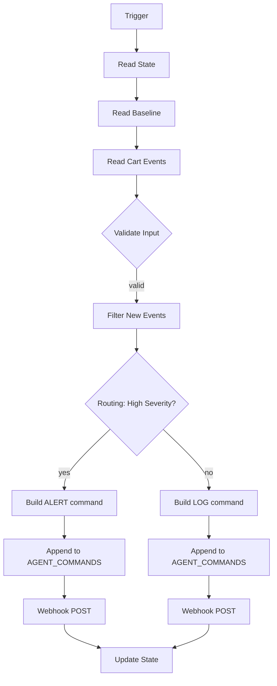
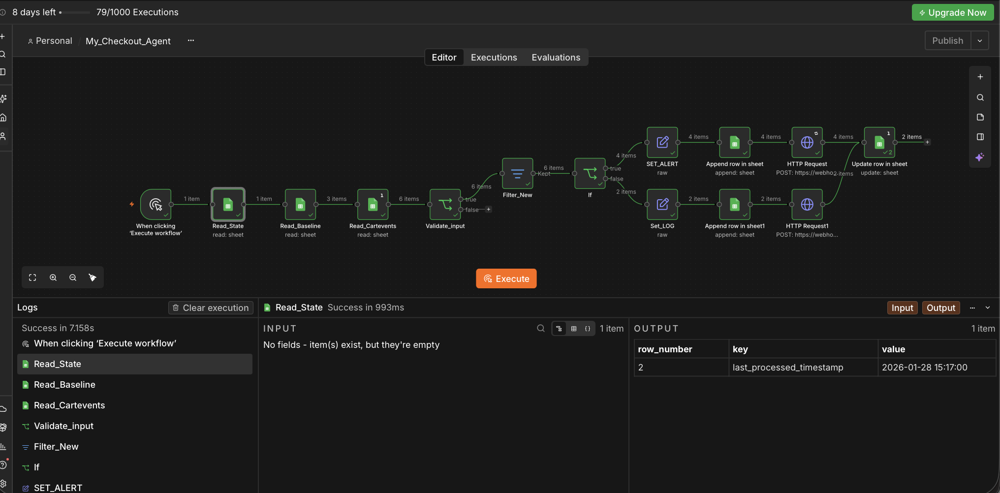
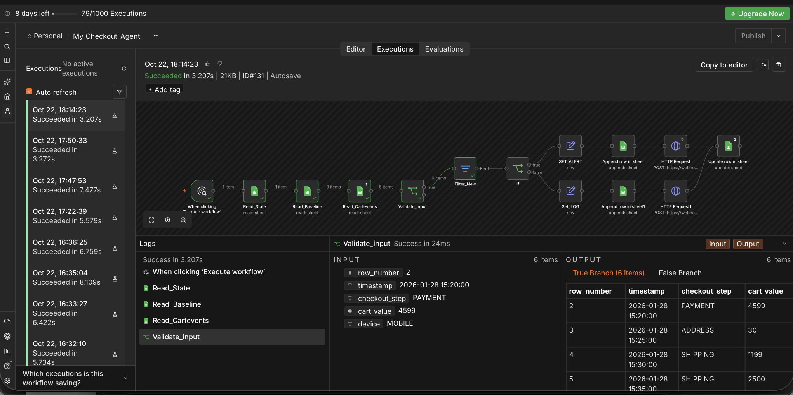

# Checkout Incident Detection Agent (n8n)

A no-code workflow in n8n that watches checkout failure events, decides if each failure is **ALERT** or **LOG**, records the decision, and sends it to a downstream system by webhook. It keeps its own state, so it never processes the same event twice.

Built as part of the Interview Kickstart AI programme (Week 1: routing design pattern).

---

## Problem

An e-commerce checkout fails at different steps: address, shipping, payment. Some failures are normal noise. Some mean revenue is being lost right now. The on-call team needs to see the serious ones fast, without being flooded by the small ones.

The agent must:
- process only new events since its last run
- compare against baseline failure rates
- decide ALERT or LOG for each event
- write one command row per decision
- send each command to a webhook
- update its state so there are zero duplicates

---

## Architecture



The flow follows one simple shape: **Gather → Check → Decide → Act → Remember**.

| Phase | Nodes | What it does |
|---|---|---|
| Gather | Read State, Read Baseline, Read Cart Events | Load memory, context and input |
| Check | Validate Input, Filter New | Reject bad rows, keep only new events |
| Decide | If (routing) | Choose ALERT or LOG path for each event at runtime |
| Act | Set ALERT / Set LOG, Append, Webhook POST | Build 9-field command, record it, send it |
| Remember | Update State | Save the latest processed event time |



---

## Data

Four Google Sheets (sample data in [`data/`](data/)):

| Sheet | Role |
|---|---|
| `cart_events` | Input: failed checkout events |
| `baseline_metrics` | Context: normal failure rate per checkout step |
| `state` | Memory: last processed event timestamp |
| `agent_commands` | Output: one command row per decision |

---

## Decision rules (routing pattern)

An event is **HIGH → ALERT** if any one rule matches. Otherwise **LOW → LOG**.

| # | Rule | Why |
|---|---|---|
| 1 | Checkout step is `PAYMENT` | Payment failure = direct revenue loss |
| 2 | Cart value ≥ 2000 | High-value customer at risk |
| 3 | Event is from mobile AND 3 or more mobile failures in this run | A group of mobile failures points to an app problem |
| 4 | No baseline exists for this step | Unknown = investigate, not ignore (fail-safe) |

The routing is done by **rules, not by an LLM**. The criteria are clear and numeric, so rules are consistent, auditable and cannot be prompt-injected.

---

## Output command (9 fields)

```json
{
  "command_id": "CMD_20261022_172243_A0",
  "action": "ALERT",
  "severity": "HIGH",
  "reason": "Payment failure",
  "checkout_step": "PAYMENT",
  "cart_value": 4599,
  "device": "MOBILE",
  "baseline_rate": "9.8",
  "timestamp": "2026-01-28 15:20:00"
}
```

---

## Test results

Sample data: 6 events, state set before all of them.

| Event | Result | Reason |
|---|---|---|
| 15:20 PAYMENT 4599 MOBILE | ALERT | Payment failure |
| 15:25 ADDRESS 30 MOBILE | ALERT | Multiple mobile failures |
| 15:30 SHIPPING 1199 DESKTOP | LOG | Low value isolated failure |
| 15:35 SHIPPING 2500 DESKTOP | ALERT | High cart value |
| 15:40 ADDRESS 150 MOBILE | ALERT | Multiple mobile failures |
| 15:45 ADDRESS 80 DESKTOP | LOG | Low value isolated failure |

| Test | Expected | Result |
|---|---|---|
| Run 1 | 6 commands written and sent, state = 15:45 | Pass |
| Run 2 (no new data) | Filter gives 0 items, nothing written or sent | Pass |
| Add 1 new event, run | Only the new event processed | Pass |

**Run 2 proof:** Validate Input passes all 6 events, but Filter New keeps 0 because the state already holds the latest timestamp. Nothing after the filter runs, so no duplicate commands are written or sent.



---

## Design decisions

**State as memory.** The workflow has no memory between runs. The `state` sheet is its memory. It stores the **event's own timestamp**, not the run time, so late-arriving events are not skipped.

**Input validation.** Event data is untrusted. Each row is checked for timestamp format, allowed step, allowed device and a positive cart value before use.

**Record before act (outbox).** Each command is written to `agent_commands` before the webhook is sent. If the webhook fails, the record is still there and can be resent.

**Unique command ID.** Each command gets a unique ID (time + branch letter + index). The receiver can use it to ignore duplicates when a webhook is retried (idempotency).

**Fail-safe.** If the baseline for a step is missing, the event goes to ALERT, not LOG. A false alarm costs less than a missed outage.

**Webhook retry.** HTTP requests retry up to 3 times on failure.

---

## Security notes

- The webhook URL and Google credentials are **not** in this repo. Credentials stay inside n8n.
- In production, the webhook needs authentication (token header or HMAC signature) and HTTPS only.
- Google access should use a service account limited to only these sheets (least privilege), not a personal account.
- Event data is untrusted input. If an LLM is added later, event fields must never be able to change the routing decision.

---

## Known limitations and next steps

| Limitation | Next step |
|---|---|
| Compares single events, not a true failure **rate** (sheet has no total checkouts) | Add total checkouts per window and compute rate vs baseline |
| One alert per event can flood on-call during an incident | Group events into one incident alert per step per window |
| State uses timestamp only; two events with the same time can be missed | Use a unique event ID or row number as state |
| Invalid rows are dropped silently | Send invalid rows to an error log and notify |
| Rules only, no AI | v2: AI Agent reads data through tools and explains; rules keep the final floor ("LLM decides, code enforces") |

---

## How to run

1. Create 4 Google Sheets from the CSV files in [`data/`](data/).
2. In n8n: **Import from File** → [`workflow/checkout_incident_agent.json`](workflow/).
3. Open each Google Sheets node and select your credential and sheet.
4. Put your own webhook URL (for testing: [webhook.site](https://webhook.site)) in the HTTP Request nodes.
5. Click **Execute workflow**.

---

## Tools

n8n · Google Sheets · Webhook (webhook.site for testing)
